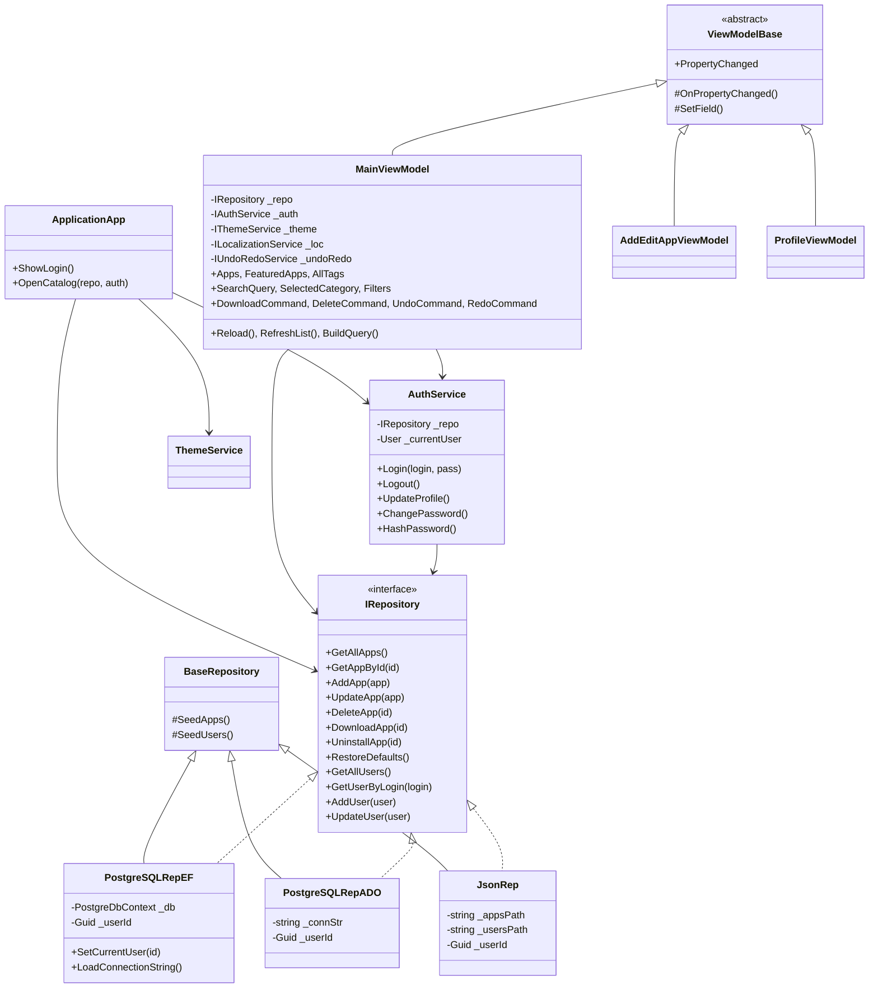
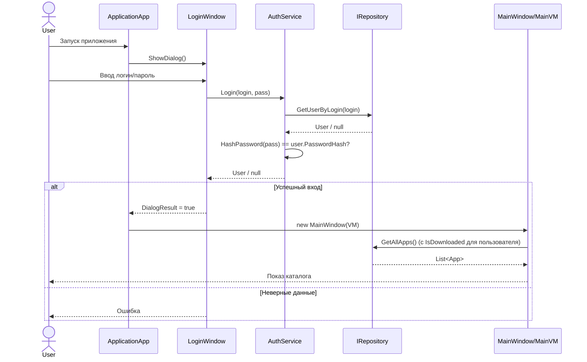

# Архитектура AppStore

## Обзор

Приложение построено по архитектурному паттерну **MVVM** (Model-View-ViewModel) с разделением на слои:

```
Presentation Layer (Views) ←→ ViewModel Layer ←→ Service Layer ←→ Data Access Layer (Repository)
```

---

## Слои

### 1. Presentation Layer (Views)
**Расположение**: `Views/`
- XAML-разметка + code-behind (только инициализация DataContext)
- Нет бизнес-логики
- Примеры: `MainWindow`, `LoginWindow`, `AppDetailView`, `AddEditWindow`, `ProfilePopup`

### 2. ViewModel Layer
**Расположение**: `ViewModels/`
- Реализуют `INotifyPropertyChanged` через `ViewModelBase`
- Содержат команды (`RelayCommand`), состояние UI, логику навигации
- Не знают о конкретных View, только о интерфейсах сервисов и репозиториев
- Основные VM:
  - `MainViewModel` — корневой, управляет каталогом, фильтрами, навигацией
  - `AddEditAppViewModel` — диалог добавления/редактирования приложения
  - `ProfileViewModel` — управление профилем пользователя

### 3. Service Layer
**Расположение**: `Services/`
- Бизнес-логика, координация между ViewModels и Repository
- Интерфейсы: `IAuthService`, `IThemeService`, `ILocalizationService`, `IUndoRedoService`
- Реализации:
  - `AuthService` — аутентификация, хеширование паролей (SHA-256), управление сессией
  - `ThemeService` — переключение Light/Dark темы через ResourceDictionary
  - `LocalizationService` — RU/EN локализация через XAML ресурсы
  - `UndoRedoService` — стек команд для Undo/Redo (паттерн Command)

### 4. Data Access Layer (Repository)
**Расположение**: `Data/`
- Интерфейс `IRepository` — контракт для работы с данными
- Три реализации (Strategy pattern):
  - `PostgreSQLRepEF` — Entity Framework Core 8 (основная)
  - `PostgreSQLRepADO` — чистый ADO.NET (Npgsql)
  - `JsonRep` — файловое хранилище (JSON, для тестов/демо)
- `BaseRepository` — общая логика сидинга тестовых данных

---

## Диаграмма классов (Mermaid)



---

## Диаграмма последовательности: Вход и открытие каталога



---

## Паттерны проектирования (используемые)

| Паттерн | Где применен | Назначение |
|---------|--------------|------------|
| **MVVM** | Весь проект | Разделение UI, логики представления, данных |
| **Repository** | `Data/IRepository` + 3 реализации | Абстракция доступа к данным, тестируемость |
| **Command** | `RelayCommand`, `IUndoRedoAction` | Инкапсуляция действий, Undo/Redo |
| **Strategy** | 3 репозитория | Переключение хранилища в runtime |
| **Factory** | `ApplicationApp` создает View/VM | Создание объектов без привязки к конкретным классам |
| **Observer** | `INotifyPropertyChanged` | Уведомление UI об изменении данных |
| **Singleton (app-scoped)** | `ThemeService`, `LocalizationService` | Глобальное состояние темы/языка |

---

## Поток данных (Data Flow)

```
User Action (Click, Input)
       │
       ▼
View (XAML) → Command Binding → ViewModel.Command
       │                              │
       │                              ▼
       │                      ViewModel Logic
       │                      (Filter, Sort, Navigate)
       │                              │
       │                              ▼
       │                      Service Layer
       │                      (Auth, Theme, Locale)
       │                              │
       │                              ▼
       │                      Repository (IRepository)
       │                              │
       ▼                              ▼
View Update ← PropertyChanged ← Model Update (App, User)
```

---

## Зависимости (NuGet)

```xml
<PackageReference Include="Newtonsoft.Json" Version="13.0.3" />
<PackageReference Include="Microsoft.EntityFrameworkCore" Version="8.0.0" />
<PackageReference Include="Microsoft.EntityFrameworkCore.Design" Version="8.0.0" />
<PackageReference Include="Npgsql.EntityFrameworkCore.PostgreSQL" Version="8.0.0" />
```

> **Примечание**: версии зафиксированы (нет `latest`). Для обновлений — явное изменение версии в `.csproj`.

---

## Расширяемость

1. **Новый репозиторий** — реализовать `IRepository`, зарегистрировать в `ApplicationApp`
2. **Новый сервис** — добавить интерфейс + реализацию, инжектировать в ViewModels
3. **Новая тема** — добавить `ResourceDictionary` в `Resources/Styles`, расширить `ThemeService`
4. **Новый язык** — добавить `.xaml` в `Resources/Localization`, расширить `LocalizationService`
5. **Новые поля App/User** — обновить `Models.cs`, EF миграцию/ADO схему, JSON сериализацию