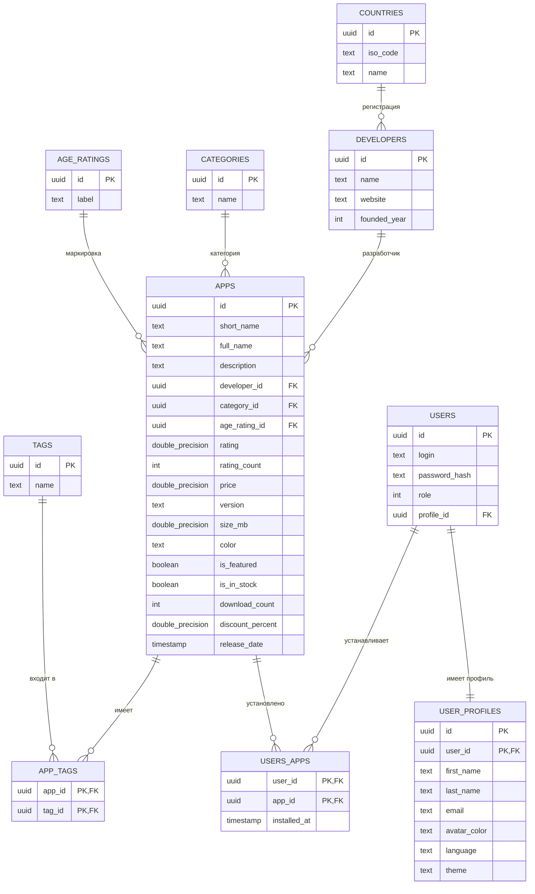

# Database Design — AppStore

**Engine**: PostgreSQL 16 (Docker: `postgres:16-alpine`)  
**ORM**: Entity Framework Core 8 (primary), ADO.NET (alternative), JSON (demo)

---

## ER Diagram (Mermaid)



---

## Table Definitions (SQL)

### `countries`
```sql
CREATE TABLE countries (
    id          uuid PRIMARY KEY DEFAULT gen_random_uuid(),
    iso_code    text NOT NULL UNIQUE,   -- ISO 3166-1 alpha-2
    name        text NOT NULL
);
```

### `developers`
```sql
CREATE TABLE developers (
    id           uuid PRIMARY KEY DEFAULT gen_random_uuid(),
    name         text NOT NULL UNIQUE,   -- организация-разработчик (издатель)
    country_id   uuid REFERENCES countries(id) ON DELETE SET NULL,
    website      text,
    founded_year integer
);
```

### `categories`
```sql
CREATE TABLE categories (
    id   uuid PRIMARY KEY DEFAULT gen_random_uuid(),
    name text NOT NULL UNIQUE           -- Design, Games, Productivity, …
);
```

### `age_ratings`
```sql
CREATE TABLE age_ratings (
    id    uuid PRIMARY KEY DEFAULT gen_random_uuid(),
    label text NOT NULL UNIQUE          -- 4+, 9+, 12+, 17+
);
```

### `tags`
```sql
CREATE TABLE tags (
    id   uuid PRIMARY KEY DEFAULT gen_random_uuid(),
    name text NOT NULL UNIQUE
);
```

### `apps`
```sql
CREATE TABLE apps (
    id                  uuid PRIMARY KEY DEFAULT gen_random_uuid(),
    short_name          text NOT NULL,
    full_name           text NOT NULL,
    description         text NOT NULL,
    developer_id        uuid REFERENCES developers(id),
    category_id         uuid REFERENCES categories(id),
    age_rating_id       uuid REFERENCES age_ratings(id),
    rating              double precision NOT NULL,
    rating_count        integer NOT NULL,
    price               double precision NOT NULL,
    version             text NOT NULL,
    size_mb             double precision NOT NULL,
    color               text NOT NULL,
    is_featured         boolean NOT NULL,
    is_in_stock         boolean NOT NULL,
    download_count      integer NOT NULL,
    discount_percent    double precision,
    release_date        timestamp without time zone NOT NULL
);

CREATE INDEX ix_apps_category  ON apps(category_id);
CREATE INDEX ix_apps_developer ON apps(developer_id);
```

### `app_tags`
```sql
CREATE TABLE app_tags (
    app_id uuid NOT NULL REFERENCES apps(id) ON DELETE CASCADE,
    tag_id uuid NOT NULL REFERENCES tags(id) ON DELETE CASCADE,
    PRIMARY KEY (app_id, tag_id)
);
```

### `users`
```sql
CREATE TABLE users (
    id              uuid PRIMARY KEY DEFAULT gen_random_uuid(),
    login           text NOT NULL UNIQUE,
    password_hash   text NOT NULL,
    role            int NOT NULL DEFAULT 0,  -- 0=User, 1=Admin
    profile_id      uuid REFERENCES user_profiles(id)
);

CREATE TABLE user_profiles (
    id              uuid PRIMARY KEY DEFAULT gen_random_uuid(),
    user_id         uuid NOT NULL UNIQUE REFERENCES users(id) ON DELETE CASCADE,
    first_name      text,
    last_name       text,
    email           text,
    avatar_color    text NOT NULL DEFAULT '#007AFF',
    language        text NOT NULL DEFAULT 'ru',
    theme           text NOT NULL DEFAULT 'light'
);
```

### `users_apps`
```sql
CREATE TABLE users_apps (
    user_id      uuid NOT NULL REFERENCES users(id) ON DELETE CASCADE,
    app_id       uuid NOT NULL REFERENCES apps(id) ON DELETE CASCADE,
    installed_at timestamp NOT NULL,
    PRIMARY KEY (user_id, app_id)
);
```

### `app_ratings`
```sql
CREATE TABLE app_ratings (
    user_id  uuid NOT NULL REFERENCES users(id) ON DELETE CASCADE,
    app_id   uuid NOT NULL REFERENCES apps(id) ON DELETE CASCADE,
    value    integer NOT NULL CHECK (value BETWEEN 1 AND 5),
    rated_at timestamp NOT NULL,
    PRIMARY KEY (user_id, app_id)
);
```

Одна оценка на пару «пользователь–приложение»: повторная оценка заменяет
прежнюю. Агрегат (`apps.rating`, `apps.rating_count`) пересчитывается в той же
транзакции модулем `RatingAggregator`. Миграция — `AddAppRatings`.

---

## Справочники в модели C#

Нормализация не меняет API моделей: `App` по-прежнему отдаёт `Developer`,
`Category`, `Country`, `AgeRating` и `Tags` строками (свойства помечены
`[NotMapped]`), а `AppStore.Core.Data.Dictionaries` содержит сущности
`Country`, `Developer`, `CatalogCategory`, `AgeRating`, `Tag`, `AppTag`.

- **Чтение**: репозитории (`PostgreSQLRepEF`, `PostgreSQLRepADO`) соединяют
  `apps` со справочниками и заполняют строковые свойства наименованиями.
- **Запись**: наименования из UI разрешаются в идентификаторы; недостающие
  строки справочников создаются (`Ensure*`/`ResolveRef`), затем пишутся связи
  `app_tags`.

---

## Seed Data (from `BaseRepository.SeedApps()` / `SeedUsers()`)

### Users (2 records)
| login | password (plain) | hash (SHA-256) | first_name | last_name | email | role | avatar_color |
|-------|------------------|----------------|------------|-----------|-------|------|--------------|
| admin | admin123 | `240be518fabd2724ddb6f04eeb1da5967448d7e831c08c8fa822809f74c720a9` | Admin | User | admin@appstore.local | 1 (Admin) | #FF6B35 |
| user  | user123  | `1a15e17c32a29ac7b8b2c8c8e8e8e8e8e8e8e8e8e8e8e8e8e8e8e8e8e8e8e8e8` | Test | User | user@appstore.local | 0 (User) | #007AFF |

> **Note**: Passwords stored as SHA-256 hex lowercase. Migration to BCrypt planned (NFR-09).

### Apps (12 records — categories: Design, Productivity, Games, Development, Education, Utilities)
| short_name | full_name | category | price | rating | featured |
|------------|-----------|----------|-------|--------|----------|
| Figma | Figma — Collaborative Interface Design | Design | 0 | 4.8 | true |
| Photoshop | Adobe Photoshop | Design | 239.88 | 4.7 | true |
| Notion | Notion — Notes, Tasks, Wiki | Productivity | 0 | 4.6 | false |
| Todoist | Todoist — To-Do List & Tasks | Productivity | 0 | 4.5 | false |
| Witcher 3 | The Witcher 3: Wild Hunt | Games | 1199 | 4.9 | true |
| Minecraft | Minecraft Java Edition | Games | 1099 | 4.8 | false |
| VS Code | Visual Studio Code | Development | 0 | 4.9 | true |
| Rider | JetBrains Rider | Development | 899 | 4.7 | false |
| Duolingo | Duolingo — Language Lessons | Education | 0 | 4.7 | false |
| Khan Academy | Khan Academy | Education | 0 | 4.8 | false |
| 7-Zip | 7-Zip File Archiver | Utilities | 0 | 4.6 | false |
| VLC | VLC Media Player | Utilities | 0 | 4.7 | false |

> Full seed data in `Data/BaseRepository.cs` → `SeedApps()` / `SeedUsers()`

---

## EF Core Mapping (from `PostgreDbContext.OnModelCreating`)

| Entity | Table | Key | Notable Config |
|--------|-------|-----|----------------|
| `App` | `apps` | `id` | `Tags` → comma-separated string (ValueConverter); `FinalPrice`, `ButtonLabel`, `IsDownloaded` ignored |
| `User` | `users` | `id` | `Login` unique; `AvatarLetter` ignored |
| `UserProfile` | `user_profiles` | `id` | `UserId` unique (1:1, cascade) |
| `UsersApps` | `users_apps` | composite (`user_id`, `app_id`) | Cascade delete both sides |

---

## Connection String

Managed by `Settings.Instance.ConnectionString`:
```
Host=localhost;Port=5433;Database=appstore;Username=postgres;Password=changeme_secure_password
```

Loaded from (priority):
1. `.env` file (local dev)
2. Environment variables (CI/prod)
3. Hardcoded defaults (fallback only)

---

## Migration Strategy

| Phase | Action |
|-------|--------|
| **Current** | `EnsureDatabaseCreated()` + raw SQL in `PostgreSQLRepEF.EnsureDatabaseCreated()` |
| **Target** | EF Core Migrations (`dotnet ef migrations add InitialCreate`) |
| **Seed** | Separate `IDbInitializer` service (not in migration) |
| **Deploy** | `dotnet ef database update` on startup (or CI) |

---

## Alternative Repositories

| Repo | Connection | Use Case |
|------|------------|----------|
| `PostgreSQLRepEF` | EF Core (Npgsql) | Primary, production |
| `PostgreSQLRepADO` | Raw Npgsql (ADO.NET) | Performance comparison, legacy |
| `JsonRep` | `Resources/Buffer/apps.json`, `users.json` | Offline demo, unit tests |

All implement `IRepository` — swap in `ApplicationApp` constructor.

---

## Backup / Restore (Docker)

```bash
# Backup
docker exec appstore-postgres-16 pg_dump -U postgres appstore > backup_$(date +%F).sql

# Restore
docker exec -i appstore-postgres-16 psql -U postgres appstore < backup_2026-10-14.sql
```

Volume: `appstore_pgdata` (persists across container restarts)