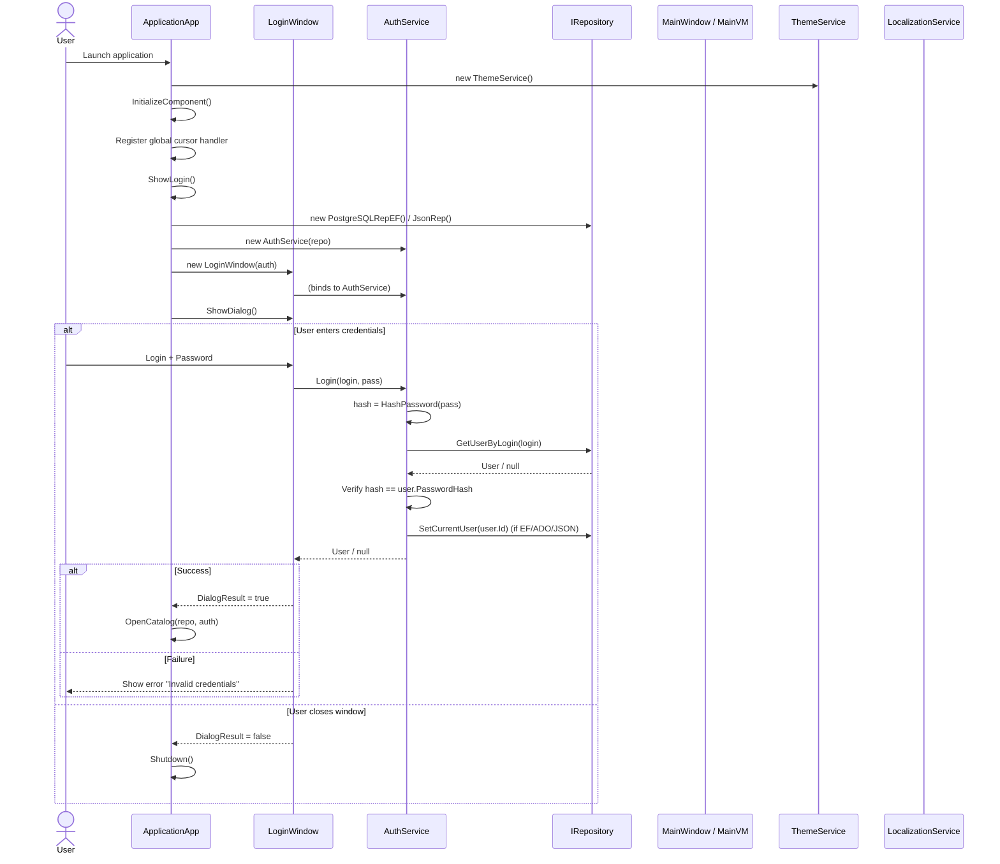
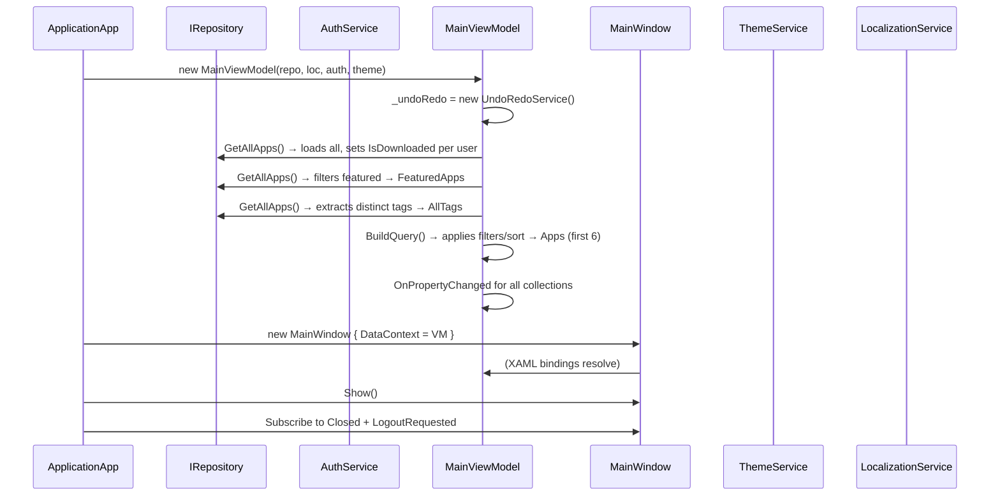
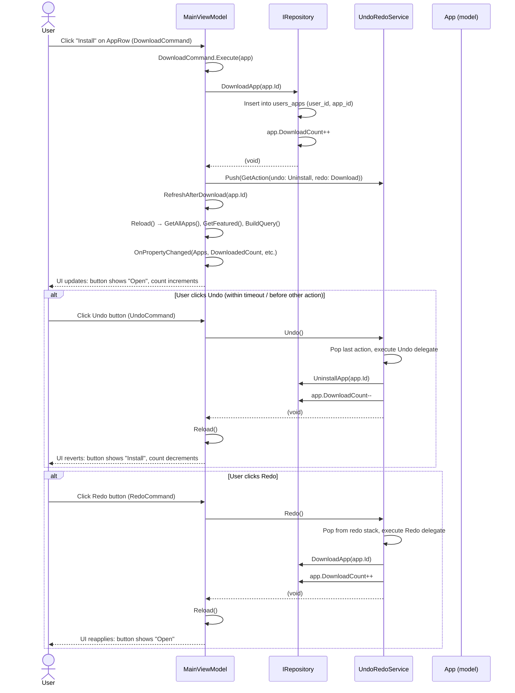
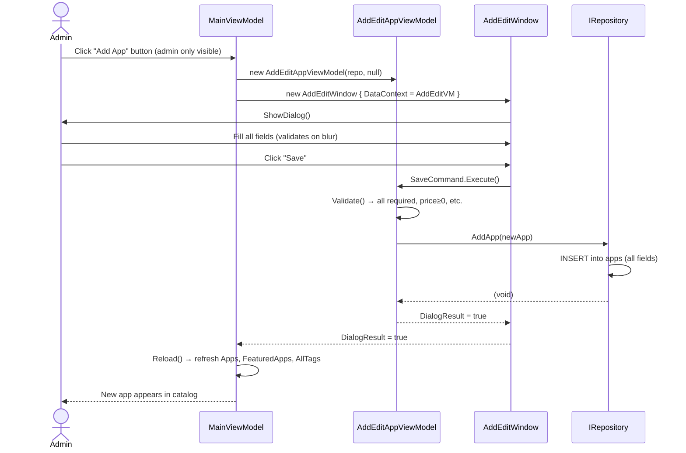
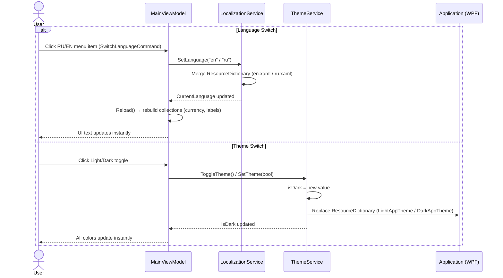
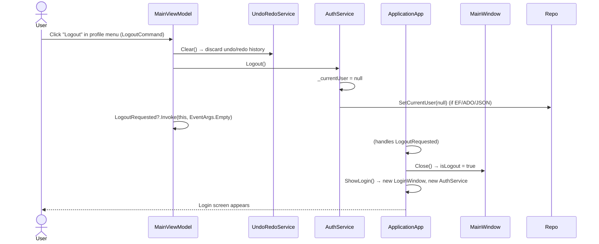

# Sequence Diagrams — AppStore

---

## SD-01: Application Startup & Login Flow

---

## SD-02: Open Catalog (Post-Login)

---

## SD-03: Client Installs App with Undo/Redo

---

## SD-04: Admin Adds New App

---

## SD-05: Language / Theme Switch

---

## SD-06: Logout & Return to Login

